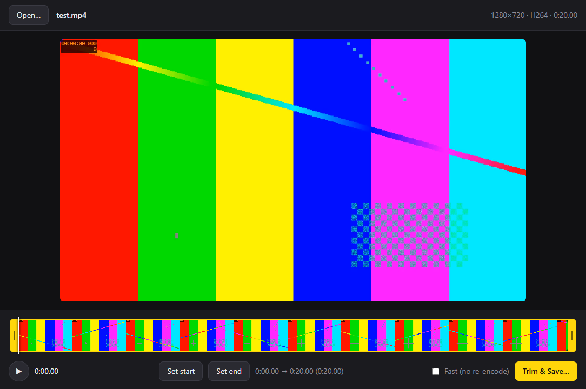

# Video Clipper

Open a video, trim it, save it. Nothing else.

Trimming a video used to be a thirty-second job. Now the tools that do it are paid, or bury it under a full editing suite. Video Clipper is a small Windows desktop app that does only this one thing, the way the trimmer on an iPhone does.



## What it does

- Opens a video file (Open button, drag and drop, or Ctrl+O).
- Shows a filmstrip timeline with a yellow handle at each end.
- Lets you drag the handles, or scrub to a spot and press **Set start** / **Set end**.
- Saves the trimmed clip in the **same container, codec and resolution** as the original.

The original file is never modified, and the app refuses to save over it.

## Getting started

You need [Node.js](https://nodejs.org) 20 or newer. ffmpeg is downloaded automatically as a dependency, so there is nothing else to install.

```powershell
git clone https://github.com/robogreg/Video_Clipper.git
cd Video_Clipper
npm install
npm start
```

### Build a standalone exe

```powershell
npm run package
```

This writes a self-contained app to `dist\Video Clipper-win32-x64\`. Run `Video Clipper.exe` from that folder, or make a shortcut to it. The folder can be copied to another Windows PC as-is.

## Using it

1. Click **Open…** and pick a video.
2. Set the part you want to keep:
   - drag the yellow handles, or
   - click or drag on the filmstrip to scrub, then press **Set start** or **Set end**.
3. Press play to check the selection. Playback stays inside the trimmed range.
4. Click **Trim & Save…** and choose where to save. The default name is `yourvideo_trimmed` next to the original.

### Keyboard shortcuts

| Key | Action |
| --- | --- |
| Space | Play / pause the selection |
| ← / → | Step one frame |
| Shift + ← / → | Step one second |
| I | Set start at the playhead |
| O | Set end at the playhead |
| Ctrl + O | Open a video |

## Exact vs. Fast

There are two ways to cut a video, and the app offers both.

| | Exact (default) | Fast (no re-encode) |
| --- | --- | --- |
| Cut position | The exact frame you chose | Start snaps back to the nearest keyframe, which can be a few seconds early |
| Speed | Re-encodes, so it takes a while on long clips | Nearly instant |
| Quality | Near-lossless re-encode in the same codec; audio is copied untouched | Bit-for-bit identical to the original |
| File size | May be somewhat larger than the same span of the original | Same bitrate as the original |

Use **Exact** when the cut point matters. Tick **Fast** when you want zero quality loss and don't mind a slightly early start.

## Supported formats

Preview uses the video player built into Electron (Chromium), so the app works with what that player can decode:

- **Works:** MP4, MOV, M4V and WebM, and most MKV files, with H.264, HEVC, VP8, VP9 or AV1 video.
- **Doesn't work:** older formats such as AVI, WMV and MPEG-2. These show a "can't be previewed" message and can't be trimmed.

HEVC preview depends on hardware decoding support on your PC.

## How it works

- [`main.js`](main.js) is the Electron main process. It handles the open and save dialogs, reads the video's codec and size, and runs ffmpeg to produce the trimmed file.
- [`preload.js`](preload.js) exposes a small, fixed set of functions to the window.
- [`renderer/`](renderer) is the window itself: the video preview, the filmstrip timeline and the controls.

ffmpeg comes from the [`ffmpeg-static`](https://www.npmjs.com/package/ffmpeg-static) package. The export is a single ffmpeg command: a stream copy in Fast mode, or a re-encode with the source codec in Exact mode.

## Credits

Built with [Electron](https://www.electronjs.org) and [FFmpeg](https://ffmpeg.org). FFmpeg is a separate program under its own license; see the `ffmpeg-static` package for details.
